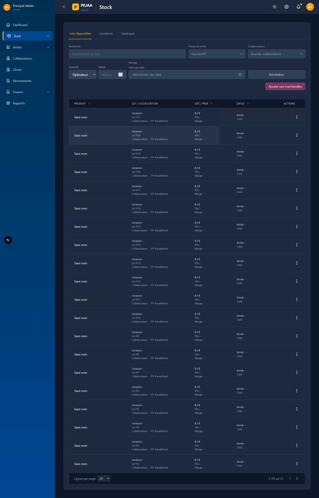
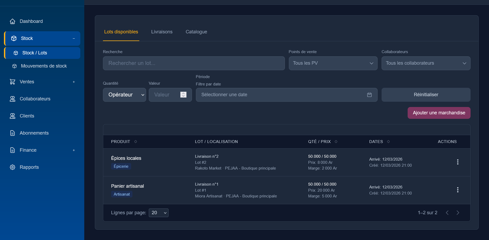
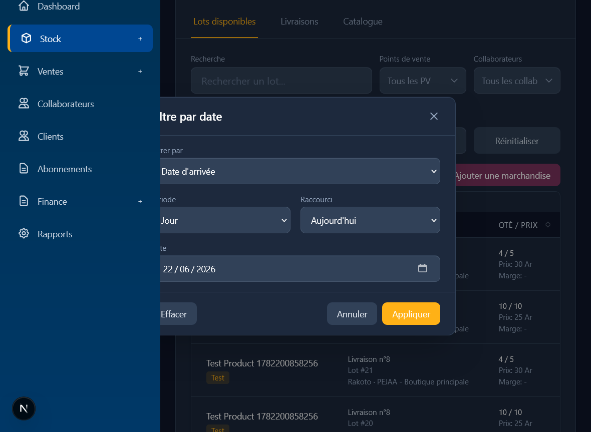

# PEJAA Next.js — Tâches restantes

> Dernière mise à jour : 2026-06-15 (Backend Overhaul — Ledger-Driven Architecture)
> ✅ = corrigé | ⬜ = à faire | 🔄 = en cours

---

## Correctifs appliqués récemment

- ✅ **API 404 (collaborateurs, points-de-vente, livraisons, encaissements)** — Les codes de domaine RBAC ne correspondaient pas à la base de données. `COLLABORATEURS` → `COLLAB` dans la route, et ajout des domaines manquants (`LIVRAISONS`, `POINTS_DE_VENTE`, `ENCAISSEMENTS`) au seed Prisma + re-seed.
- ✅ **CSS reset écrasait les classes Tailwind** — Le reset `* { margin: 0; padding: 0 }` dans `globals.css` n'était pas dans un `@layer base`, ce qui le rendait prioritaire sur toutes les utilities Tailwind v4. Déplacé dans `@layer base`.
- ✅ **Dark mode Tailwind v4 ne fonctionnait pas** — Ajout de `@custom-variant dark (&:where(.dark, .dark *));` dans `globals.css` pour activer le toggle de classe.
- ✅ **Caractère parasite "0" dans AdminLayout** — Un `0` s'affichait avant `{children}`. Supprimé + padding rendu responsive (`p-4 md:p-6 lg:p-10`).
- ✅ **Login page redesign** — Refaite avec classes Tailwind responsive (pas de pixels inline), thème sombre, espacement correct.
- ✅ **Route `/config` → `/settings`** — Dossier renommé, références mises à jour dans `layout.tsx`, `SettingsDropdown.tsx`, `proxy.ts`.
- ✅ **Profil & mot de passe** — Modals implémentés dans `UserOverlay.tsx` + endpoints `PUT /api/auth/profile` et `POST /api/auth/change-password`. `updateUser` ajouté à `AuthContext`.
- ✅ **Sidebar performance** — `transition-all` → `transition-[width]`, `visibleItems` mémoisé avec `useMemo`, durée réduite à 200ms.

---

## Bugs restants

### Profil & mot de passe
- ✅ Les boutons "Mon profil" et "Changer mot de passe" dans le UserOverlay ouvrent maintenant des modals fonctionnels avec les endpoints API correspondants.

### Route `/config` vs `/settings`
- ✅ Résolu : dossier `config` renommé en `settings`, sidebar et references mis à jour. Les sous-pages (`/settings/points`, etc.) restent à créer.

### Sidebar
- ✅ **Performance** : `transition-all` remplacé par `transition-[width]`, `visibleItems` mémoisé avec `useMemo`, durée réduite à 200ms.
- ⬜ Le sidebar doit être rétractable avec seulement le badge "P" et les icônes visibles quand rétracté (en cours, partiellement fonctionnel).

### Thème
- ⬜ Vérifier que le toggle dark/light fonctionne correctement sur toutes les pages après le fix `@custom-variant dark`.
- ⬜ Le thème couleur (Soleil / Océan) change les variables CSS mais vérifier visuellement que l'océan applique bien ses couleurs.

---

## Pages manquantes (routes frontend)

Les routes sont définies dans `layouts/Sidebar.tsx` mais les pages correspondantes n'existent pas encore dans `app/(admin)/` :

| Route | Statut | Description |
|-------|--------|-------------|
| `/pos` | ⬜ | Point de vente / Caisse — interface de vente rapide |
| `/commandes` | ⬜ | Gestion des commandes clients |
| `/clients` | ⬜ | Liste et gestion des clients |
| `/abonnements` | ⬜ | Gestion des abonnements et paiements |
| `/reports` | ⬜ | Rapports (bénéfices, revenus, stock snapshot) |
| `/settings` | ✅ | Configuration générale (dossier renommé de `config` → `settings`) |
| `/settings/points` | ⬜ | Gestion des points de vente |
| `/settings/unites` | ⬜ | Gestion des unités de mesure |
| `/settings/produits` | ⬜ | Admin produits catalogue |
| `/settings/security` | ⬜ | RBAC & utilisateurs |
| `/admin-tools` | ⬜ | Outils super-admin (audit, kill-switch, DB reset) |

---

## Schéma Prisma — Architecture Ledger-Driven ✅

> Refonte complète effectuée : 27 modèles, architecture 3 journaux (stock_mouvement, transaction_financiere, comptabilité optionnelle).
> Voir `next_app/docs/architecture-ledgers.md` et `next_app/docs/database-schema.md`.

### Modèles renommés
- ✅ `Lot` → `LivraisonItem` (lignes de livraison)
- ✅ `StockLocal` → `StockActuel` (photo du stock, source de vérité)
- ✅ `TransfertStock` → `StockTransfert`

### Nouveaux modèles
- ✅ `CommandeLigne` (lignes de commandes)
- ✅ `StockAjustement` (legacy, ajustements manuels)
- ✅ `RetourCollaborateur` (legacy, retours)

### Enrichissements
- ✅ `StockMouvement` : ajout `before_qty`, `after_qty`, `source_type`, `source_id`
- ✅ `Vente` : `id_point_vente`, `date_vente`, `montant_ht/tva/marge/total`, soft-delete (`deleted`, `deleted_at`)
- ✅ `VenteArticle` : `quantite_vendue` (Int), `prix_initial`, `id_lot` requis, `id_collaborateur` requis, `montant_ht/tva/marge`
- ✅ `TransactionFinanciere` : `id_categorie_financiere` requis, `source_module` requis, `created_by` requis
- ✅ `ProduitCatalogue` : `id_collaborateur`, `categorie`, `unite`, `seuil_alerte`, `created_by`, `modified_by`
- ✅ `Livraison` : header + `LivraisonItem` lines, `id_collaborateur` requis
- ✅ `FinancialCategory` : 7 catégories seedées

### Seed & Tests
- ✅ Seed complet : 5 collabs, 25 produits, 4 livraisons (13 items), 10 ventes (20 articles) avec écritures ledger
- ✅ 25 tests API vitest (auth, ventes, stock, livraisons, produits) — tous passent

---

## Fonctionnalités métier à implémenter

### Module Finance
- ⬜ CRUD `financial_category` (API + page)
- ⬜ Endpoint rapports : `GET /api/rapports/benefices` (Rapport 1 — bénéfices PEJAA)
- ⬜ Endpoint rapports : `GET /api/rapports/revenus` (Rapport 2 — revenus collaborateurs)
- ⬜ Endpoint rapports : `POST /api/rapports/stock-snapshots/generer` + `GET /api/rapports/stock-snapshots/:id` (Rapport 3)
- ⬜ Calcul de `marge_effective` basé sur l'abonnement actif du collaborateur

### Module Abonnements
- ⬜ Page `/abonnements` avec liste, création, édition des types d'abonnement
- ⬜ Association abonnement ↔ collaborateur avec période
- ⬜ Enregistrement des paiements d'abonnement
- ⬜ Cron job pour rappels d'abonnement (hebdomadaire)

### Module Ventes
- ⬜ Modal de vente avec sélection de lot, client (anonyme par défaut), multi-articles
- ⬜ Garde-fous UI : ne pas vendre plus que la quantité disponible, validation du formulaire
- ✅ La vente crée atomiquement : `vente` + `vente_article` + `stock_mouvement(sortie)` + `transaction_financiere(IN)` (backend implémenté)
- ✅ Décrémente `stock_actuel.quantite` lors de la vente (backend implémenté)

### Module Stock
- ⬜ Refactor de la page stock selon les spécifications de `documentation/UX-UI_Guide/Left_to_do.md` :
  - Onglets : Lots disponibles (par défaut) | Livraisons | Catalogue
  - Colonnes lots : produit+catégorie, livraison n°+lot id, collaborateur, qt actuelle/qt initiale, prix initial+marge, emplacement, date arrivée
  - Actions par ligne : détails, vendre, ajustement, transfert/scindement, retourner
- ⬜ Filtres actifs avec chips (croix pour désactiver)
- ⬜ Filtre par quantité (=, <, >) pour les lots
- ⬜ Pagination fonctionnelle (actuellement décorative)
- ⬜ Tri colonnes : asc → desc → neutre
- ⬜ Drawer de détails sur clic de ligne

### Module Collaborateurs
- ⬜ Écran complet avec CRUD, filtres, drawer de détails
- ⬜ Vue des produits/lots/ventes par collaborateur

### Module Clients
- ⬜ Page liste clients avec CRUD basique
- ⬜ Historique d'achats par client

---

## UI/UX — Règles générales

Voir `.windsurf/rules/ui_spacing.md` pour les règles d'espacement (Tailwind classes, responsive, padding minimum).

- ⬜ Toutes les pages doivent utiliser des classes Tailwind (pas de `style={{ padding }}` inline)
- ⬜ Responsive par défaut : `p-4 md:p-10` pour les containers
- ⬜ Filtres affichés en chips avec croix pour reset
- ⬜ Drawer/modal de détails pour chaque entité métier
- ⬜ Clic droit ou appui long sur ligne de tableau → menu contextuel d'actions

---

## Infrastructure & DevOps

- ⬜ Middleware Next.js pour protection des routes (redirection vers /login si pas de cookie)
- ✅ Tests API pour les endpoints principaux (vitest) — 25 tests : auth, ventes, stock, livraisons, produits
- ⬜ Tests E2E pour les workflows critiques (vente, livraison)
- ⬜ CI/CD pipeline
- ✅ `.env.example` existe et est à jour (DATABASE_URL, JWT, Cloudinary, PEJAA_BACK_URL)

## Remarques
- ✅ Documentation complète des tables dans `next_app/docs/database-schema.md` (champs commentés, clés étrangères)
- ✅ Documentation architecture ledger dans `next_app/docs/architecture-ledgers.md`
- ✅ `Pejaa_Back/docs/database-schema.md` mis à jour (stock_mouvement: before_qty, after_qty, source_type, source_id)
- ✅ `Pejaa_Back/docs/database-schema-v2.md` mis à jour ("implémenté")
- ✅ Seed frais : 5 collaborateurs × 5 produits, 4 livraisons (5+2+3+3 items), 10 ventes × 2 articles avec ledger complet
- ✅ Tests API vitest créés et fonctionnels (auth, ventes, stock, livraisons, produits)

## Problèmes n°1
- Arrivé à 540 de largeur d'écran, le side bar ne se compresse plus et ça fait apparaître un scrollbar horizontal. Le titre peut être enlevé et les icônes de thème sombre et claire, l'icône réglages et notification peuvent être réuni dans un drop down.
- En même temps il faut corriger correctement ce souci ci :  Le résultat attendu est 
Le souci : Dans produit, pour épicerie locales dans le seed de pejaa back on peut voir que dans la colonne produit 2 informations. (Epicerie locales et Epicerie pour épicerie locale) Trouves de quels colonnes il s'agit puis corrige la récupération de ces informations pour toutes les colonnes de la version next. On voit sans nom dans tous les lignes de colonne produit et le point de vente affiche PV #undefined. Prix marge et quantité ne sont pas récupérés et la colonne date est atrocément vide. Si tu veux regarde dans le navigateur le serveur des deux sont ouverts sur 5174 pour le pejaa front et 6969 pour le next 

## Vagues de problèmes n°2
- Il n'y a rien dans l'onglet livraison. Le datatable n'est juste pas là
- Dans l'onglet catalogue des stock de marchandises, il faut montrer le colaborateur relié au produit. Le mieux est de mettre le collaborateur dans la colonne produit en bas du nom du produit et il faut pouvoir filtrer le tout selon l'auteur qu'on met dans un drop box.
- La colonne action est trop large et le data table a un scroll. On veut qu'il n'y ait pas de scroll. Je ne veux pas dire par là qu'il faut enlever l'option scroll du datatable mais de compacter le tableau en fusionnant les colonnes stock et seuil comme pour l'onglet lots disponibles.
-  Les filtres en généraux comme les champs de textes et les combobox avec dropdowns puis les checkbox et date doivent être caché. On appuie sur un bouton avec une icone et un texte filtre avancé pour voir les champs et boutons qui ne sont pas nécessaires. 
- Le champ catégorie doit être un champ de saisie avec dropbox avec tous les catégories recencés. Il faut indexer la catégorie pour optimiser le truc ou bien est ce que tu as une idée plus intéressant.
- Il manque le champ seuil sur le formulaire d'inscription. Dans les actions on doit pouvoir modifier le seuil.
- Le champ collaborateur lui même doit être un champ de texte avec un drop box.
- Pour le champ de formulaire dans Ajouter une marchandise, il faut aussi que les champs collaborateurs et point de vente
- Les modals comme le component date range filter ou le modal pour ajouter un lot. Ils glichent et passent en dessous du sidebar.
- J'aimerais que tu me prompt le processus d'ajout d'une marchandise au complet. J'aimerais améliorer l'ux et l'ui mais fait quand même les suggestions que j'ai fait dans ce batch de rôle. 

## Wave 3
- Au niveau de saisie globale des livraisons, la zone de footer DOM Path: div.min-h-.creen flex bg-.late-50 dark:bg-.late-900 relative > div.flex-1 flex flex-col min-w-0 > main.flex-1 overflow-y-auto bg-.late-50 dark:bg-.late-900 > div.p-4 md:p-6 lg:p-10 > div.fixed in.et-0 > div.ab.olute in.et-y-0 right-0 flex max-w-full > div.w-.creen max-w-5xl bg-white dark:bg-.late-800 .hadow-2xl border-l border-.late-200 dark:border-.late-700 flex flex-col animate-.lide-in-right > div.flex-1 overflow-y-auto px-4 md:px-6 py-4 > div.h-[calc(100vh-8rem)] min-h-[520px] -mx-4 md:-mx-6 > div.flex flex-col h-full min-h-[480px] bg-.late-900 text-.late-100 overflow-hidden rounded-lg border border-.late-700 > div.bg-.late-800 border-t border-.late-700 px-4 py-2.5 flex flex-wrap item.-center gap-6 .hrink-0
Position: top=374px, left=2px, width=870px, height=37px
React Component: DynamicEntryMetricsBar
HTML Element: 
Total articles: 4 Coût initial total: 12 000 Ar Profit potentiel estimé: 1 200 Ar
 doit être calculé en fonction de toutes les produits à travers les différents onglets et non juste pour l'onglet actuel. Les toasts de confirmations attestant une livraison effectué doit se mettre en premier plan. Là il apparaît juste derrière l'écran de saisie globale des livraisons et on ne vois pas visuellement si ça a bien été enregistré ou non.
Je me rends compte que les SelectWithTags ne sont pas comme je les voudrais. Ah je m'en souviens maintenant. Au faite je veux TypeaheadSelect au lieu de SelectWithTags. Je veux un champ où l'on peut chercher la valeur en tapant des caractères parmis ceux qui sont en option. 
Au niveau du champ saisie globale des ventes, j'aimerais savoir à quoi correspond le champ Réduc. et ses propriétés. Le toast d'enregistrement est caché ici aussi. Il faut arranger ça. Et j'ai ces issues : "## Error Type
 Error Message
Encountered two children with the same key, `40`. Keys should be unique so that components maintain their identity across updates. Non-unique keys may cause children to be duplicated and/or omitted — the behavior is unsupported and could change in a future version avec plusieurs éléments. 

## Wave 4
- Au niveau du saisie global des livraisons, les selectwithtags n'ont pas été échangés contre des typeheadselect. Incluant le modal pour "Ajouter un collaborateur"
- Lorsque le side bar est plié, les menus Stock, ventes ; ceux avec des sous menus ont des comportements anormaux. Lorsqu'on appuie dessus une erreur survient : "Runtime Error
Maximum update depth exceeded. This can happen when a component repeatedly calls setState inside componentWillUpdate or componentDidUpdate. React limits the number of nested updates to prevent infinite loops.

layouts/Sidebar.tsx (196:5) @ Sidebar.useLayoutEffect

  194 |     const pos = positionAnchor(flyout.id)
  195 |     if (!pos) return
> 196 |     setFlyout(prev => prev ? { ...prev, top: pos.top, left: pos.left } : null)
      |     ^
  197 |   }, [flyout, isOpen, positionAnchor])
  198 |
  199 |   useEffect(() => {

Call Stack 131
Show 128 ignore-listed frame(s)
Sidebar.useLayoutEffect" Normalement de base quand on appuie sur un menu du side bar plié, ça se déplie et affiche les sous menus mais ici ce n'est pas le cas. Pour stock par exemple il y a les sous menus "Stock / Lots" et "Mouvements de stock"
- Il manque des champs de saisie qu'il faut ajouter dans la saisie globale des livraisons. Il faut ajouter un champ commentaire lié à livraison.commentaire et un champ référence prérempli par la date et heure actuelle pour la valeur par défaut.

### Ajout massif pour la vue de produit_catalogue.
- Petit modif pour Stock/lots / catalogue. Ici tous les produits catalogue sont regroupés. Ce que je veux c'est de pouvoir consulter tous les lots dans la table stock actuel qui sont tous du même produit catalogue que celui qui est séléctionné. On pourra alors voir de là combien de lot sont en circulation pour ce produit catalogue en particulier. On pourra voir comme informations : Prix initial et marge (livraison_item.prix_initial, marge), point de vente, identifiant de livraison (livraison_item.id_livraison), quantité actuel (stock_actuel.quantite) Slash "/" livraison_item.quantite_initiale. Quand on clique sur une ligne du tableau catalogue, on affiche un drawer plein écran qui montre dans des cards ou des lignes les informations précisés précédemment et des infos jugés utiles. Quand on ouvre 1 de ces lignes ou card, on tombe sur un modal qui affiche les informations relatif au lot : D'abord dans un premier text field, on affiche les infos lié au produit : infos catalogue comme le nom du produit produit_catalogue.nom et l'identifiant produit_catalogue.id_produit ou mettre ça en titre pourquoi pas ; Afficher le nom du collaborateur à l'aide de produit_catalogue.id_collaborateur ; afficher la catégorie du produit à l'aide de produit_catalogue.categorie ; afficher la description textuelle produit_catalogue.description. Afficher la date de création (produit_catalogue.created_at) et le créateur produit_catalogue.created_by (c'est un identifiant et il faut trouver l'user dans utilisateur.id_utilisateur).
Deuxièmement dans un nouveau text field, afficher les informations relatif au livraison comme l'id de livraison, l'id livraison item, la date d'arrivée, le point de vente de déstination (livraison.id_pdv ou stock_actuel.id_pdv), create_by et created_at dans livraison item.
Dans un dernier text field, le prix inital dans livraison_item avec la marge, la quantité initial de livraison item slash / quantité actuel dans stock_actuel. Puis il faut montrer combien d'argent ce lot a réussi à générer. 
- Il faut mettre les quantités / quantités dans des badges et le nom des collaborateurs aussi pour les rendre facile à repérer. 
- Il faut aussi ajouter un bouton paramètre qui affiche un menu flottant pour renseigner des actions. Par exemple pour vendre expressement le lot sélectionné.
- Action vendre : Redirige l'utilisateur vers la saisie globale des ventes avec le produit actuel de sélectionné
- Action Ajuster la quantité : qui crée un mouvement de stock de type ajustement de stock créant des entrées dans les tables stock_mouvement et stock_ajustement.
- Action Transfert vers un autre point de vente : qui crée des entrées dans stock_transfert et stock_mouvement aussi.
- Note pour l'agent il faut consulter les tables concernés pour bien regarder les tables à remplir dans chaque cas d'utilisation comme le type de mouvement dans stock_mouvement, date mouvement, source_type, type, id de lot, motif qu'il faut ajouter à stock mouvement.
- Action pour ajuster le prix d'un livraison item et la marge (qui ne modifie pas du tout les ventes passés).

### Vue aggrégé des ventes
- Lorsqu'on passe en vue aggrégé pour la vente on tombe sur l'erreur : "Console Error
Encountered two children with the same key, `40`. Keys should be unique so that components maintain their identity across updates. Non-unique keys may cause children to be duplicated and/or omitted — the behavior is unsupported and could change in a future version.

components/ResponsiveDataTable/ResponsiveDataTable.tsx (375:15) @ ResponsiveDataTable/<.children<.children<.children<.children<

  373 |           <tbody className="divide-y divide-border-subtle dark:divide-slate-700">
  374 |             {data.map((row, rowIndex) => (
> 375 |               <tr
      |               ^
  376 |                 key={row.id || rowIndex}
  377 |                 className={`transition-colors ${onRowClick ? 'cursor-pointer hover:bg-primary/5 dark:hover:bg...
  378 |                 onClick={() => onRowClick && onRowClick(row)}

Call Stack 25
Show 21 ignore-listed frame(s)
tr
unknown (0:0)
ResponsiveDataTable/<.children<.children<.children<.children<
components/ResponsiveDataTable/ResponsiveDataTable.tsx (375:15)
ResponsiveDataTable
components/ResponsiveDataTable/ResponsiveDataTable.tsx (374:19)
VentesPage
app/(admin)/ventes/page.tsx (294:7)" 

### Pages à implémenter - Clients & abonnement.
- Il faut commencer à implémenter la table clients qui va contenir des informations sur les clients. Mets un responsive data table où l'on verra les informations de base d'un client. Quand on clique sur un client, on ouvre soit un modal soit un drawer pour montrer tous les détails du client. Il faut également montrer tout ce qu'il a acheté jusqu'ici et le profit obtenu grace au client. Afficher la marge uniquement, la quantité et le bénéfice produit des 2 informations précédents. Il faut utiliser le composant daterangefilter pour filtrer tout ça correctement. 

#### Abonnement

